# Photography & Camera Settings Notes

Single-page revision guide for **filmmaking**, **still photography**, **tone curves & color grading**, and **visual cheat sheets**.

## Contents
- [1. Video and Filmmaking Camera Basics](#1-video-and-filmmaking-camera-basics)
  - [Frame Rate (FPS)](#frame-rate-fps)
  - [Light Meter and Exposure Settings](#light-meter-and-exposure-settings)
  - [ISO (Video)](#iso-video)
  - [Shutter Speed (Video)](#shutter-speed-video)
  - [Aperture (Video)](#aperture-video)
  - [White Balance](#white-balance)
  - [Video Setup Order](#video-setup-order)
- [2. Photography Exposure and Camera Settings](#2-photography-exposure-and-camera-settings)
  - [Exposure and the 4 Questions](#exposure-and-the-4-questions)
  - [The Exposure Triangle and Stops](#the-exposure-triangle-and-stops)
  - [Aperture (F-Stop) and Depth of Field](#aperture-f-stop-and-depth-of-field)
  - [ISO (Digital Gain vs. Film Sensitivity)](#iso-digital-gain-vs-film-sensitivity)
  - [Shutter Speed, Handheld Rule, and Tripods](#shutter-speed-handheld-rule-and-tripods)
  - [Neutral Density (ND / VND) Filters](#neutral-density-nd--vnd-filters)
  - [Priority Modes (Av / Tv vs. Manual)](#priority-modes-av--tv-vs-manual)
- [3. Tone Curves and RGB Color Grading](#3-tone-curves-and-rgb-color-grading)
  - [Basic Components of a Tone Curve](#basic-components-of-a-tone-curve)
  - [Common Curves](#common-curves)
  - [RGB Curves (Color Opposites)](#rgb-curves-color-opposites)
  - [Making an Image Cooler](#making-an-image-cooler)
  - [Adding Warmth](#adding-warmth)
  - [Skin Tone Adjustment](#skin-tone-adjustment)
- [4. Photography Visual Cheat Sheets](#4-photography-visual-cheat-sheets)
  - [Exposure Triangle Overview](#exposure-triangle-overview)
  - [Camera Mode Dial and Controls](#camera-mode-dial-and-controls)
  - [ISO Quick Guide](#iso-quick-guide)
  - [Aperture Cheat Sheets](#aperture-cheat-sheets)
  - [Shutter Speed Cheat Sheet and Anti-Shake Rule](#shutter-speed-cheat-sheet-and-anti-shake-rule)
  - [Outdoor Exposure: Sunny 16 Rule](#outdoor-exposure-sunny-16-rule)
  - [Focal Length and Angle of View](#focal-length-and-angle-of-view)
  - [Metering Modes, White Balance, and Travel Summary](#metering-modes-white-balance-and-travel-summary)
- [5. Video vs. Photo Quick Rules](#5-video-vs-photo-quick-rules)

---

## 1. Video and Filmmaking Camera Basics

> Reference: [Master Your Camera in 20 Minutes | Tomorrow's Filmmakers](https://www.youtube.com/watch?v=HTUjJoMNWqo)

- Always shoot video on **Manual Mode** so brightness doesn't flicker mid-clip.

### Frame Rate (FPS)
- How many frames are captured in 1 second.
- **24fps:** Industry standard, most natural cinematic look.
- **60fps:** Used for slow motion (slow-mo).

### Light Meter and Exposure Settings
- **ISO**, **Aperture**, and **Shutter Speed** control exposure.
- Check the **Light Meter** on the back of your camera:
  - Keep the meter in the middle (**0** = properly exposed).
  - Minus (**-**) = too dark | Plus (**+**) = too bright.

### ISO (Video)
- Affects exposure ("fake light" — digital brightness).
- Ranges from **100** up to **160,000+** (hundreds of thousands).
- Higher number = brighter image, but adds **grain/noise** (looks like **TV static**, less clear).
- Lower number = darker image, cleaner quality.
- Keep it as low as possible (try to stay **under 1000**).

### Shutter Speed (Video)
- How long the sensor is exposed to light — like the **eyelid** of your camera.
- Affects exposure **and** motion blur:
  - **Slow shutter speed:** Brighter (more light enters) + more motion blur.
  - **Fast shutter speed:** Darker (less light enters) + freezes moving objects (almost no blur).
- **Natural motion blur rule (180-degree rule):** Set shutter speed to **double your frame rate** (e.g., **24fps → 1/50s**).
- **Creative effects:**
  - **Daydream / dreamy look:** Slow shutter.
  - **Jittery / war-like action look:** Fast (high) shutter (e.g., *Saving Private Ryan* style).

### Aperture (Video)
- Like the **pupil / eyeball** of your camera.
- Affects exposure **and** controls **depth of field** (how blurry the background is).
- **Lower f-stop (e.g., F/1.4):** Wide opening = more light + blurry background (shallow depth of field, great for portraits).
- **Higher f-stop (e.g., F/16):** Small/closed opening = less light + sharp background (everything in focus).
- Normal/kit lenses usually only open to around **F/3.5–F/5.6** (or F/4.5); lower minimum f-stop lenses cost more.

### White Balance
- Tells the camera what pure white is.
- If set wrong, shots look **too warm** (orange) or **too cool** (blue).
- Set it manually instead of Auto:
  - Hold a **gray card** in front of the lens and set **Custom White Balance**, OR
  - Dial in a **custom Kelvin temperature**.

### Video Setup Order
1. Set **Frame Rate** (24fps normal or 60fps slow-mo).
2. Lock **Shutter Speed** at double your fps (24fps → `1/50s`) so motion blur stays natural.
3. Set **White Balance** (gray card / custom Kelvin).
4. Set **ISO** as low as possible (**100** outdoors).
5. Adjust **Aperture** for background blur and check the **Light Meter** (aim for **0**):
   - Still too dark indoors → open Aperture wider first, then raise ISO last (keep under 1000 if possible).
   - Too bright outdoors in sunlight → make sure ISO is at 100 first; if you still want a blurry background (low f-stop), put on an **ND filter** (sunglasses for your lens), or close the Aperture (higher f-stop).

---

## 2. Photography Exposure and Camera Settings

### Exposure and the 4 Questions
- **Exposure** = total amount of light passing through the **Aperture** (lens) → **Shutter** → hitting the **Sensor / Film (ISO)**.
- **3 Types of Exposure:**
  - **Incorrect Exposure:** Too dark or too bright.
  - **Correct Exposure:** Brightness, shadows, and highlights look fine (what Auto mode gives), but depth of field and motion are ignored.
  - **Creatively Correct Exposure:** You deliberately choose **Aperture**, **Shutter Speed**, and **ISO** to control sharpness, background blur, and motion.
- **4 Questions Before Every Shot:**
  1. What **ISO** (or film) should I use?
  2. How much **Depth of Field** (background blur) do I want?
  3. Is there **Motion** in the frame (or camera shake)?
  4. How do I want that motion to look (**frozen** or **blurred/streaked**)?

### The Exposure Triangle and Stops
- **Aperture, Shutter Speed, and ISO** are connected: changing one changes brightness, so you must compensate with one or both of the others.
- **Stop** = doubling (`+1 stop`) or halving (`-1 stop`) the light:
  - **Shutter Speed:** Halving/doubling time = 1 stop (e.g., `1/60s` → `1/125s` = `-1 stop`; `1/60s` → `1/30s` = `+1 stop`).
  - **ISO:** Halving/doubling number = 1 stop (e.g., `100` → `200` → `400` → `800`).
  - **Aperture:** Film lenses mark full stops directly on the ring; digital dials usually move in **1/3 stop** per click.

### Aperture (F-Stop) and Depth of Field
- **F-Stop Formula:** `F` (focal length) `/` `stop number` (on a `50mm` lens, `F/2.8` = `17.85mm` opening; `F/22` = `2.27mm` opening).
- **Reversed Number Rule:**
  - **Smaller F-number (`F/1.4`, `F/2.8`)** = larger opening = **more light** + **shallow depth of field** (blurry background).
  - **Larger F-number (`F/11`, `F/22`)** = smaller opening = **less light** + **deep depth of field** (more foreground & background in focus).
- **Landscape Sweet Spot: `F/8` to `F/11`** — Sharpens foreground and background without closing down too far (at `F/22`, even dust on the front of the lens can come into focus).
- **Extra Blur Tips:**
  - Depth of field gets shallower when you **zoom in more** and increase **distance between subject and background**.
  - When everything is far away with no foreground (distant mountains), `F/2.8` and `F/22` look nearly identical.

### ISO (Digital Gain vs. Film Sensitivity)
- **Digital:** ISO is **gain** (electrical boost through the sensor). Higher gain = brighter image, **more digital noise**. Can be changed anytime.
- **Film:** Fixed by the roll's **box speed** (`Velvia 50`, `Ektar 100`, `ColorPlus 200`, `Portra 400`, `Portra 800`). Higher ISO film = more **film grain**.
- **Base ISO:** Usually the lowest native ISO (e.g., `125`), where the sensor performs cleanest. **Stay at Base ISO whenever light allows.**
- **High ISO Trade-off:** In low light without a tripod, pushing ISO (even up to `12,800`) is worth the grain if it lets you keep a fast enough shutter speed for a sharp handheld shot.

### Shutter Speed, Handheld Rule, and Tripods
- **Fast Shutter (`1/250s`, `1/500s`, `1/8000s`):** Less light, **freezes motion** (crisp water droplets, running subject).
- **Slow Shutter (`1/30s`, `1s–10s`, `30s`):** More light, **blurs/streaks motion** (soft waterfalls, car light trails; `1s` keeps water texture, `10s` makes it silky smooth).
- **Handheld Rule:**
  - **`1/60s` or faster** = generally safe handheld.
  - **`1/30s` or slower** = likely to introduce blur from hand shake.
- **Long Exposure / Tripod Tip:**
  - Most cameras max out natively at **30 seconds**.
  - Put the camera on a **tripod**, use **Base ISO**, and set a **2-second self-timer** so pressing the shutter button doesn't shake the camera.

### Neutral Density (ND / VND) Filters
- Dark glass placed in front of the lens to cut down light (sunglasses for the lens).
- **Variable ND (VND):** Two polarizing filters stacked together — rotate to adjust how much light is blocked.
- **Use case:** In bright daylight, when you want a **slow shutter speed** (`1s–10s` for soft water) while keeping **Base ISO** and your chosen **Aperture** (`F/11`).

### Priority Modes (Av / Tv vs. Manual)
- **Aperture Priority (`A` / `Av`):** You set Aperture + Base ISO (or **Auto ISO** in low light); camera sets Shutter Speed. Best for landscapes, portraits, still scenes.
- **Shutter Priority (`S` / `Tv`):** You set Shutter Speed (e.g., `1/500s`–`1/8000s` to freeze action); camera sets Aperture & ISO. Best for sports and fast motion.
- **Full Manual (`M`):** Use when **both** Depth of Field and Motion must be controlled together (daylight long-exposure waterfalls, handheld low light at `F/11` + `1/60s`, or `30s` night light trails on a tripod).

---

## 3. Tone Curves and RGB Color Grading

### Basic Components of a Tone Curve
From bottom-left (darkest) to top-right (brightest):
1. **Blacks** (bottom-left corner)
2. **Shadows** (lower-left quarter)
3. **Midtones** (center)
4. **Highlights** (upper-right quarter)
5. **Whites** (top-right corner)

- **Channels:** Master/RGB (overall brightness & contrast), **Red**, **Green**, **Blue**.
- **Axis reminder:** Moving a point **up** brightens that range (or adds that color); moving a point **down** darkens it (or adds the opposite color).

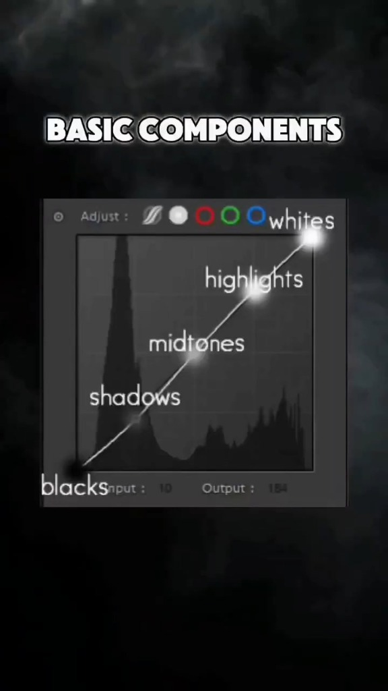

### Common Curves
- **S Curve (Contrast):** Pull **shadows down** slightly and push **highlights up** slightly → adds punch/contrast.
- **The Matte Look:** Lift the **bottom-left black point** upward off the bottom edge → turns pure blacks into faded dark gray.
- **Increase Highlights:** Place a dot in upper-right (**highlights**) and drag **upward**.
- **Increase Shadows:** Place a dot in lower-left (**shadows**) and drag **upward**.

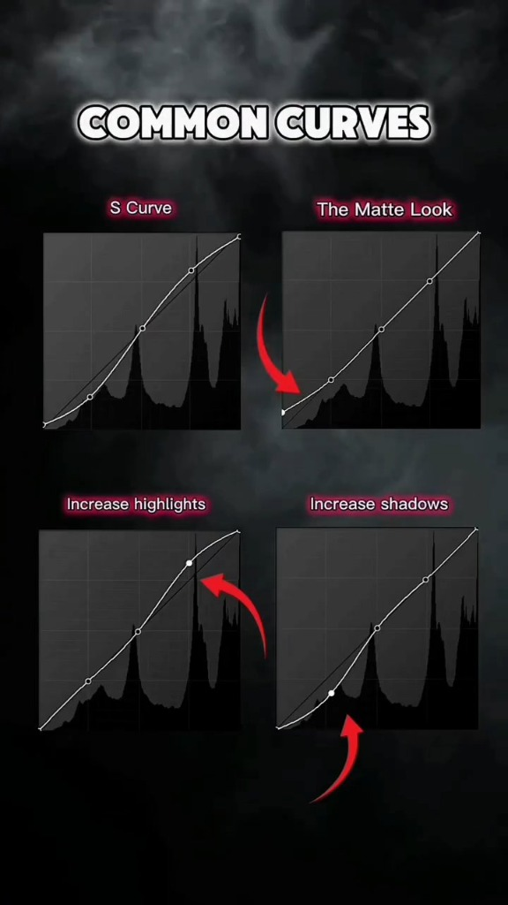

### RGB Curves (Color Opposites)
- **Red Channel:** Pull **Up** = **Red** | Pull **Down** = **Teal**
- **Green Channel:** Pull **Up** = **Green** | Pull **Down** = **Magenta**
- **Blue Channel:** Pull **Up** = **Blue** | Pull **Down** = **Yellow**

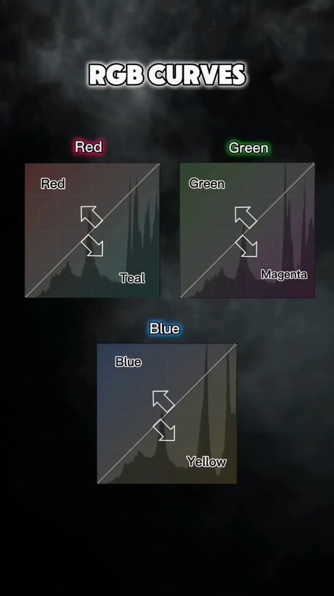

### Making an Image Cooler
1. **Reduce Red:** Pull **down** the midtones on the **Red channel** → removes red and adds **teal**.
2. **Increase Blue:** Drag **up** the midtones on the **Blue channel** → adds **blue**.
3. **Optional Tip:** Nudge the **Green channel** slightly up or down to fine-tune.

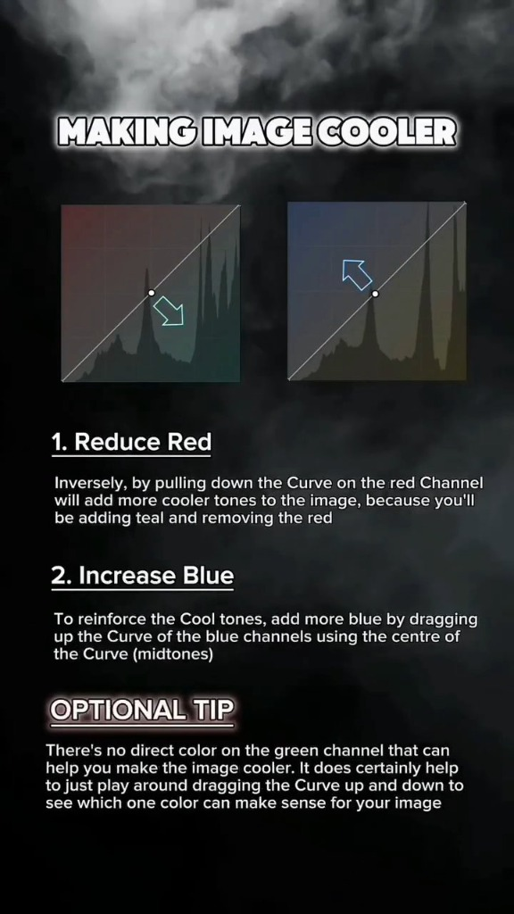

### Adding Warmth
1. **Increase Red:** Pull **up** the midtones (center dot) on the **Red channel** → adds **red** and reduces teal.
2. **Reduce Blue:** Drag **down** the midtones on the **Blue channel** → adds **yellow** warmth.
3. **Extra Perk:** Slightly pulling **up** the midtones on the **Green channel** can sometimes help add warmth.

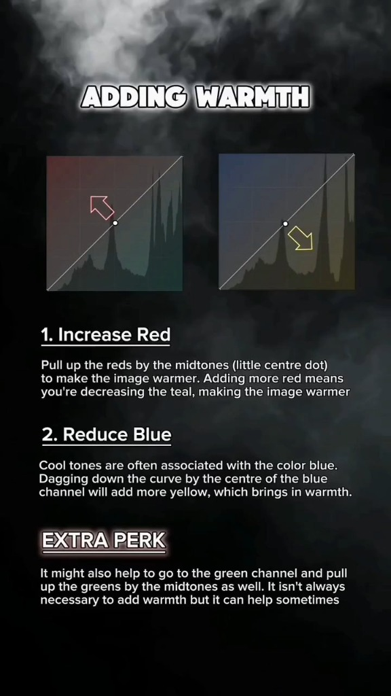

### Skin Tone Adjustment
1. Place anchor dots for shadows, midtones, and highlights on each channel.
2. Toggle through **Red**, **Green**, and **Blue** channels and slightly **lower the shadow dot** on each:
   - **Red (down):** Adds a touch of **teal** to shadows.
   - **Green (down):** Adds **magenta** (with teal → warm **brownish** base).
   - **Blue (down):** Adds a little **yellow** to tie the skin tone together naturally (works ~99% of the time).

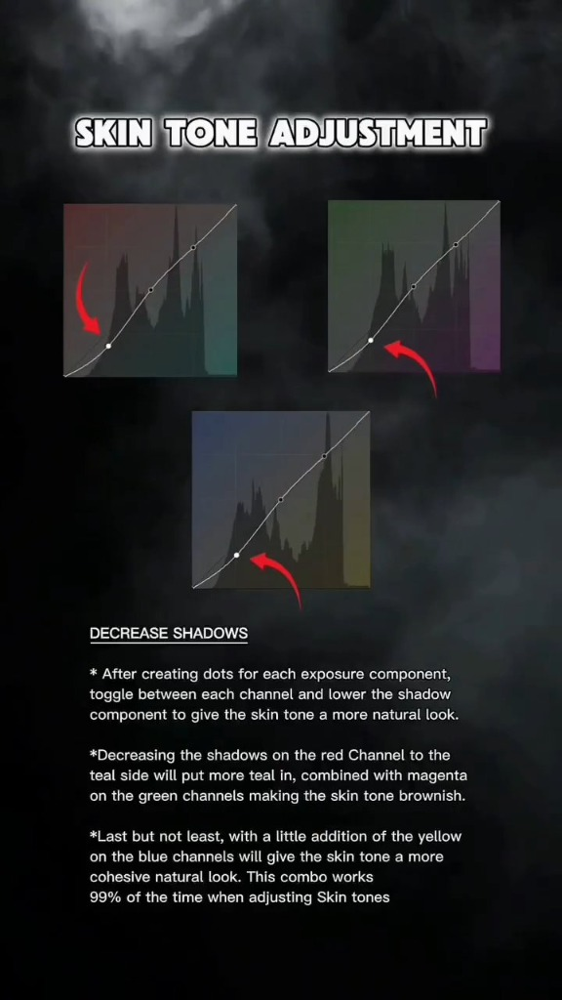

---

## 4. Photography Visual Cheat Sheets

### Exposure Triangle Overview
- Keep the light meter on **0** (`-3` underexposed / darker ↔ `+3` overexposed / brighter).

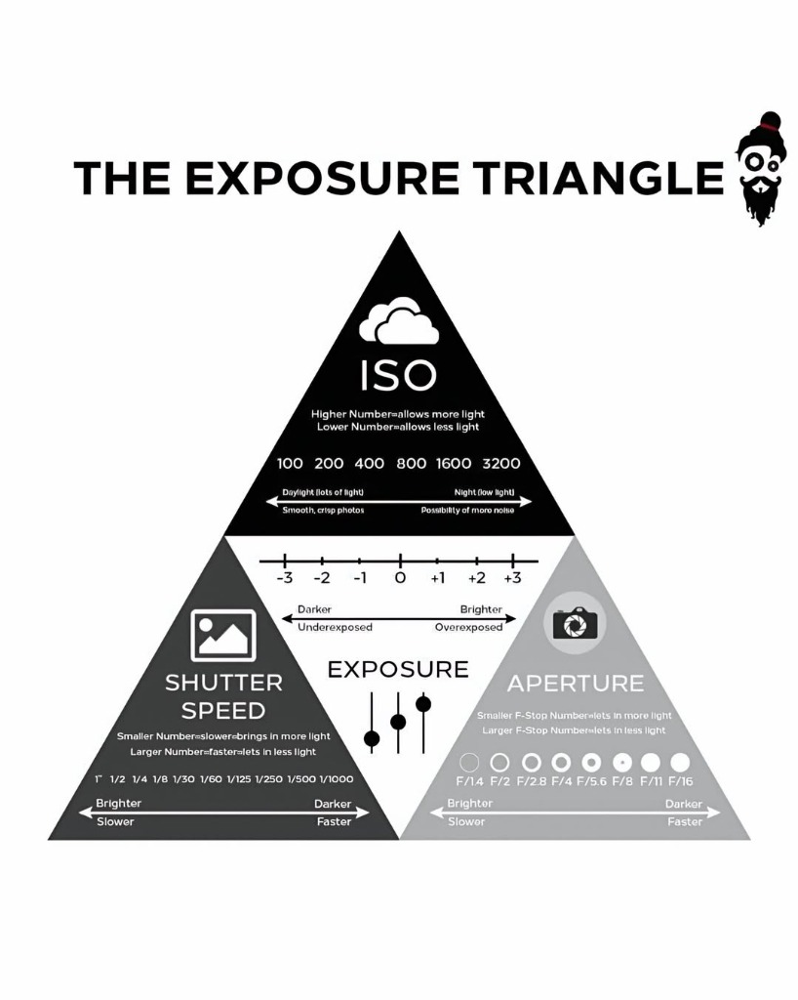

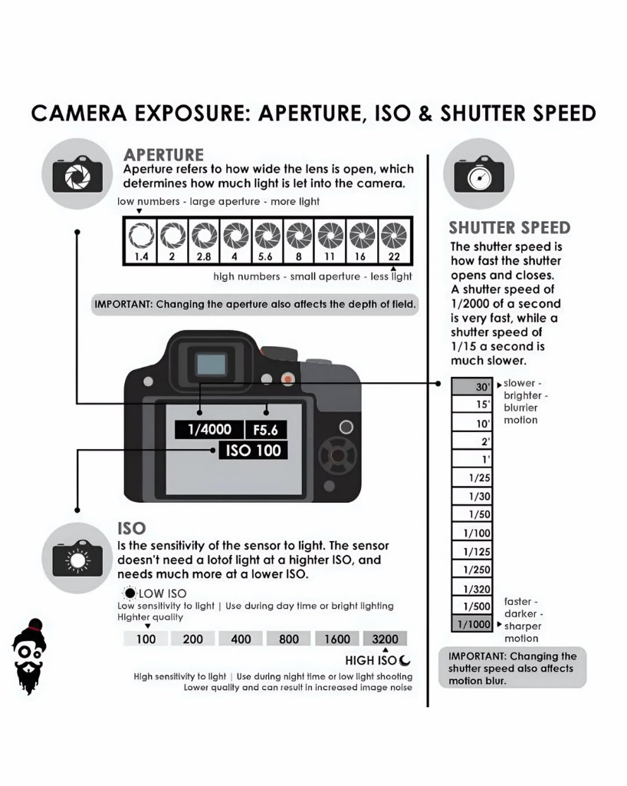

### Camera Mode Dial and Controls
- **M:** Manual | **Av / A:** Aperture Priority | **Tv / S:** Shutter Priority | **P:** Program
- **On-Screen Quick Items:** Shutter Speed, Aperture, ISO, Shooting Mode, Exposure Level, White Balance (`AWB`), Focus Mode (`ONE SHOT` / AF), Drive Mode, Image Quality (`L` / RAW).

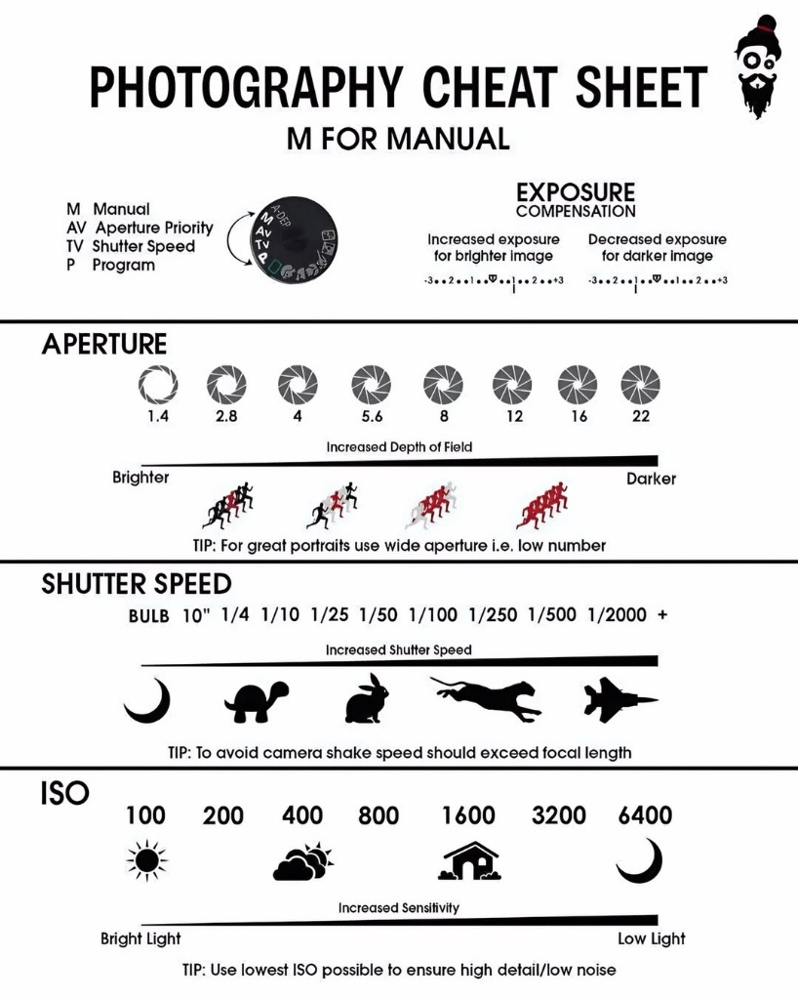

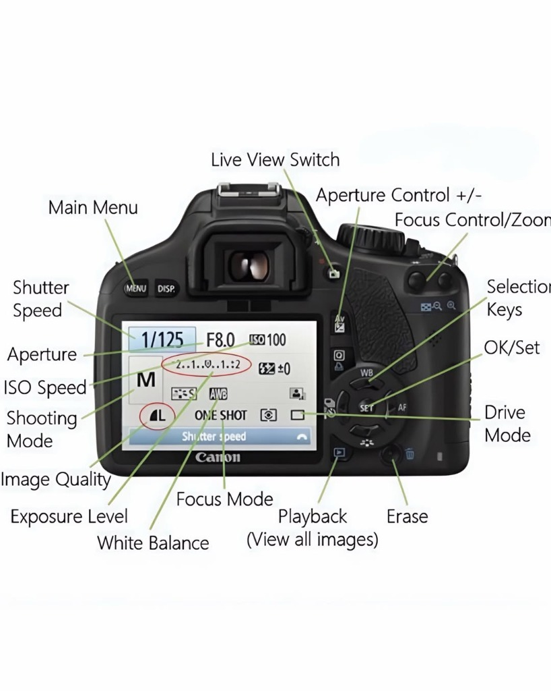

### ISO Quick Guide
- **ISO 100–200:** Bright daylight
- **ISO 200–400:** Shade / bright indoors
- **ISO 400–800:** Flash indoors
- **ISO 800–1600:** Darker indoors
- **ISO 1600–3200:** Indoors at night (stay below ~2000 when possible)
- **ISO 3200–6400+:** Extra low light (more grain/noise)

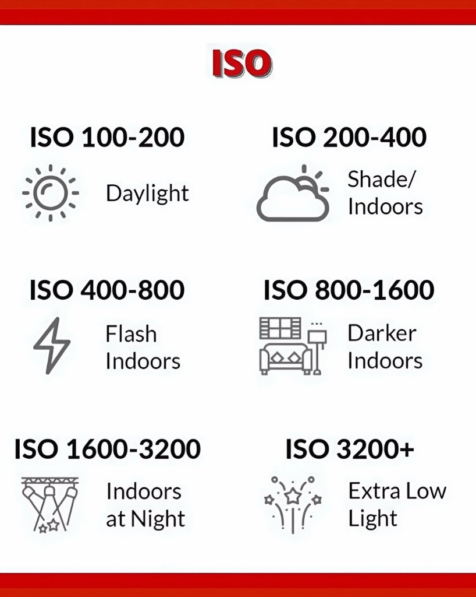

### Aperture Cheat Sheets
- **f/1.2 – f/1.4:** Low light, portraits, razor-thin depth of field
- **f/2:** Portraits (strong background blur)
- **f/2.8:** Portraits, low light, human action
- **f/4.0:** Wildlife
- **f/5.6:** Groups, mid-day shots, product photography (often lens sweet spot for sharpness)
- **f/8:** Landscapes, travel, real estate (nearly entire scene in focus)
- **f/11:** Macro with details
- **f/12 – f/16:** Landscapes with deep depth, longer daytime exposures

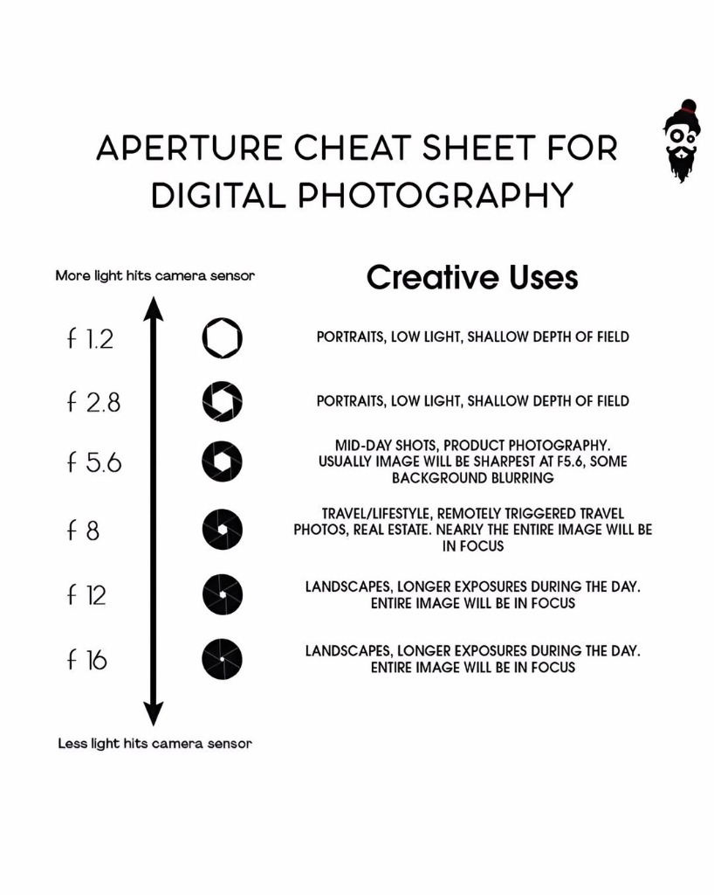

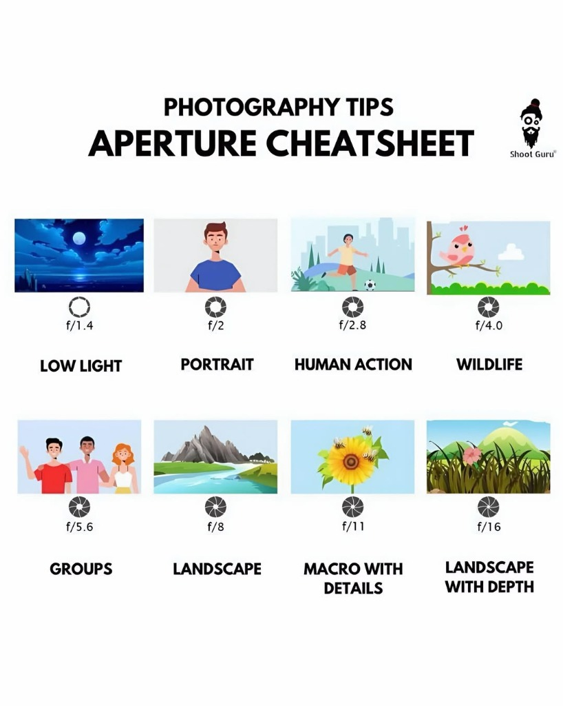

### Shutter Speed Cheat Sheet and Anti-Shake Rule
- **1/4000s:** Fast animals, sports | **1/2000s:** Sunset/sunrise | **1/1000s:** Races, extreme sports | **1/500s:** Slower sports
- **1/250s:** Casual photography | **1/120s:** Panning fast vehicles | **1/60s:** Panning slower objects (min handheld)
- **1/30s:** Blurring motion | **1/15s:** Low light without flash | **1/8s:** Blurring moving water | **1/4s:** Blurring motion
- **1/2s:** Extreme low light | **1":** Fireworks | **5–30":** Light painting, starscapes | **BULB:** Night sky / long exposure
- **Anti-Camera-Shake (Reciprocal) Rule:** Shutter speed should be faster than **`1 / focal length`** (e.g., `50mm` → `1/50s`–`1/60s`+; `200mm` → `1/200s`–`1/250s`+).

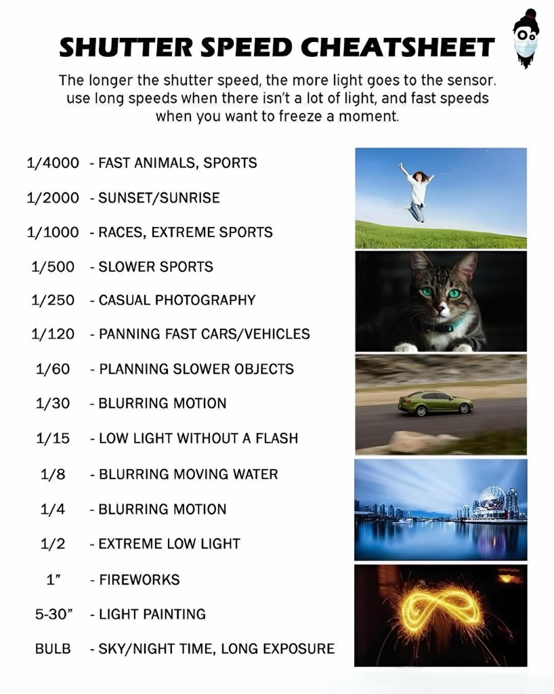

### Outdoor Exposure: Sunny 16 Rule
Set **Shutter Speed ≈ 1 / ISO** (ISO 100 → `1/125s`, ISO 400 → `1/500s`, ISO 800 → `1/1000s`), then set Aperture by light:
- **Snow / Sand:** `f/22`
- **Sunny (Hard Shadows):** `f/16`
- **Sunny (Soft Shadows):** `f/11`
- **Cloudy:** `f/8`
- **Shade:** `f/5.6`
*(For side-lit or back-lit subjects, open up 1–2 stops if exposing for the subject rather than the bright sky.)*

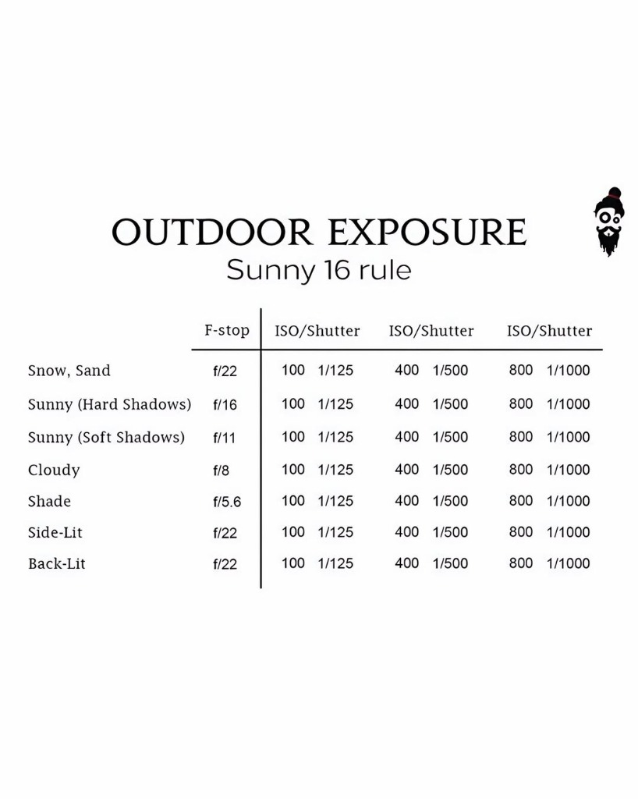

### Focal Length and Angle of View
- **Fisheye (180°)** / **14mm (114°) – 24mm (84°):** Extreme Wide Angle (architecture, interiors)
- **28mm (75°) – 35mm (63°):** Wide Angle (landscapes, large group portraits)
- **50mm (46°):** Normal (everyday snapshots)
- **70mm (34°) – 100mm (24°):** Medium Telephoto (portraits, children; `85mm` classic portrait)
- **135mm (18°) – 200mm (12°):** Telephoto (close-by wildlife, sports)
- **300mm (8°) – 600mm (4°):** Super Telephoto (distant subjects, birds)

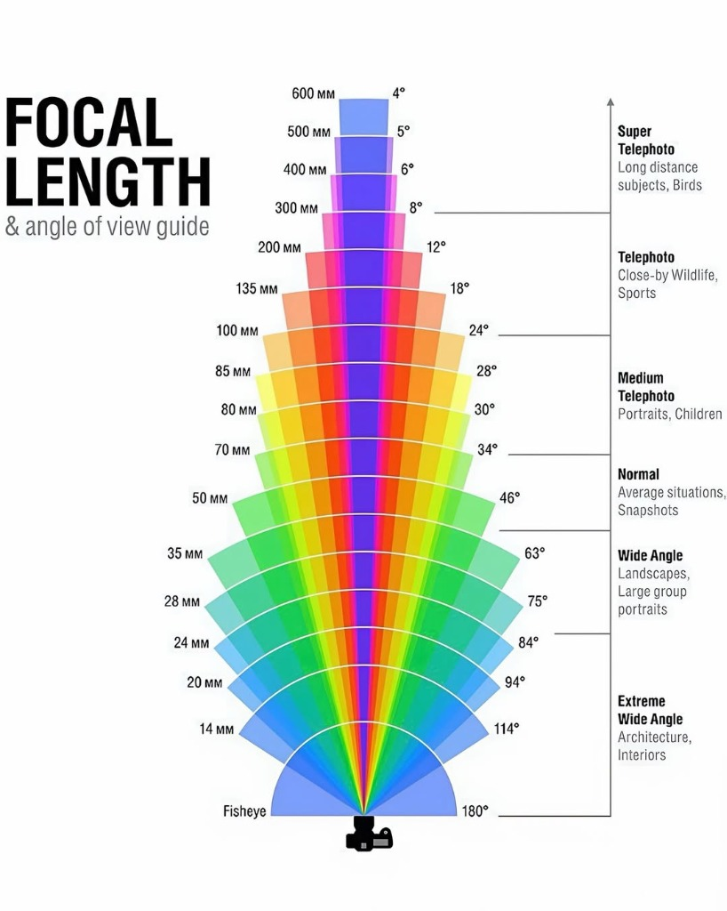

### Metering Modes, White Balance, and Travel Summary
- **Metering Modes:** **Evaluative / Matrix** (whole scene — default), **Center-Weighted** (center priority), **Spot** (single spot — great for backlit/stage shots).
- **White Balance Presets:** `AWB`, Daylight, Cloudy, Shade, Fluorescent, Tungsten, Flash, **Kelvin (`K`)**, **Custom**.
- **Reference Setups (Meter at `0`, Evaluative, Custom WB):** Studio = `1/125s`, `f/8`, `ISO 100` | Daylight Portrait = `1/250s`, `f/1.4`, `ISO 100`.

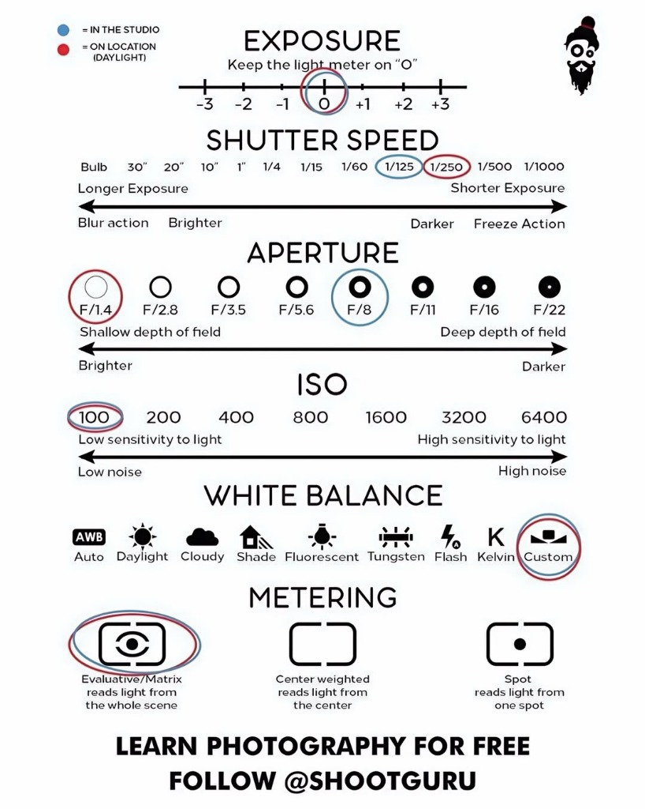

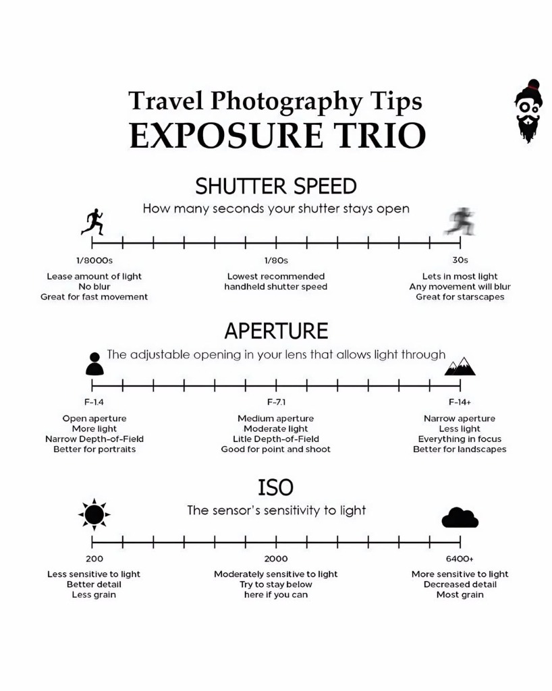

---

## 5. Video vs. Photo Quick Rules
- **Shooting Video?** Lock **24fps + 1/50s** shutter (180° rule), set **White Balance** manually, keep **ISO** as low as possible (`< 1000`), and control daylight brightness with **Aperture + ND filter**.
- **Shooting Photos?** Use **Aperture Priority (`Av`)** or **Shutter Priority (`Tv`)** most of the time, stay at **Base ISO** when light allows, keep handheld shutter **≥ 1/60s** (or `> 1 / focal length`), use **`f/8–f/11`** for landscapes, and switch to **Manual + Tripod** for long exposures.
