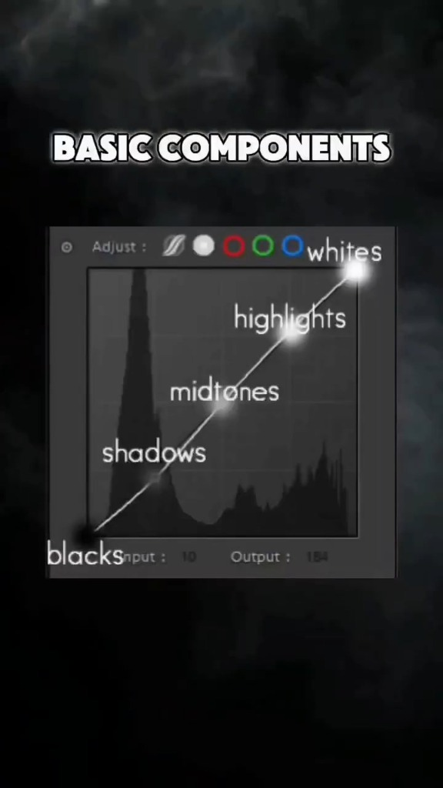
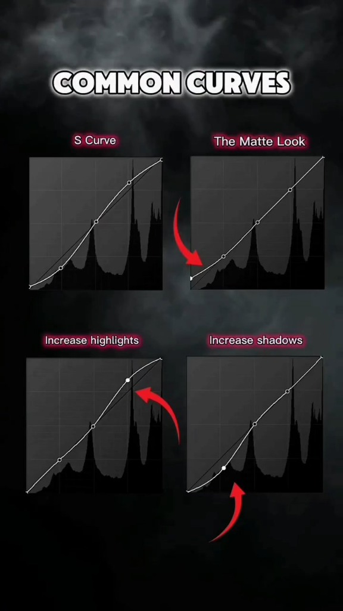
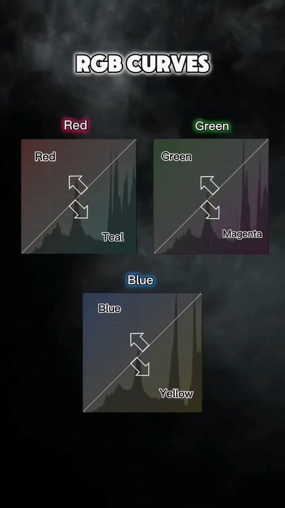
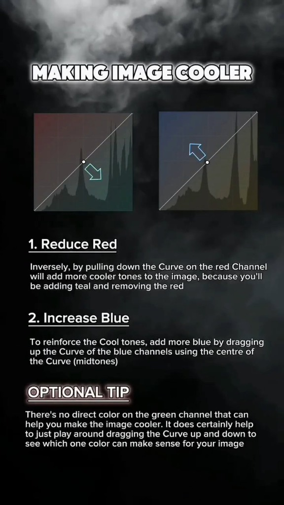
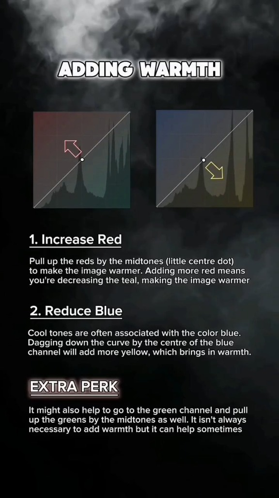
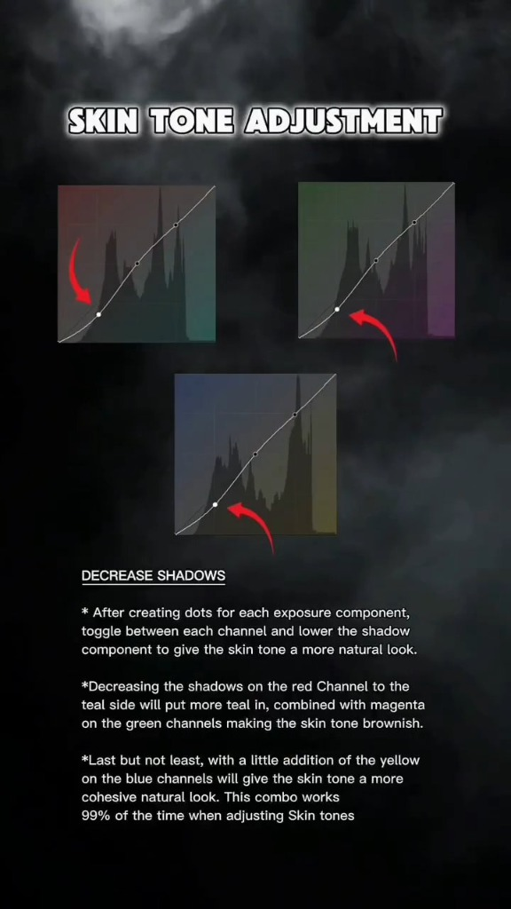

# Tone Curves & RGB Color Grading

## 1. Basic Components of a Tone Curve
From bottom-left (darkest) to top-right (brightest):
1. **Blacks** (bottom-left corner)
2. **Shadows** (lower-left quarter)
3. **Midtones** (center)
4. **Highlights** (upper-right quarter)
5. **Whites** (top-right corner)

- **Channels you can adjust:** Master/RGB (overall brightness & contrast), **Red**, **Green**, **Blue**.
- **Axis reminder:** Moving a point **up** brightens that tonal range (or adds that color); moving a point **down** darkens it (or adds the opposite color).

---

## 2. Common Curves (Master / Luma Curve)
- **S Curve (Contrast):** Pull **shadows down** slightly and push **highlights up** slightly to create an S-shape → adds punch/contrast.
- **The Matte Look:** Lift the **bottom-left black point** upward off the bottom edge → turns pure blacks into faded dark gray for a film/matte look.
- **Increase Highlights:** Place a dot in the upper-right (**highlights**) and drag it **upward** (keeping midtones/shadows anchored) → brightens highlights.
- **Increase Shadows:** Place a dot in the lower-left (**shadows**) and drag it **upward** → lifts/brightens shadows.

---

## 3. RGB Curves (Color Opposites)
Each color channel has an opposite color when pulled down:
- **Red Channel:** Pull **Up** = **Red** | Pull **Down** = **Teal**
- **Green Channel:** Pull **Up** = **Green** | Pull **Down** = **Magenta**
- **Blue Channel:** Pull **Up** = **Blue** | Pull **Down** = **Yellow**

---

## 4. Making an Image Cooler
1. **Reduce Red:** Pull **down** the midtones (center) on the **Red channel** → removes red and adds **teal**.
2. **Increase Blue:** Drag **up** the midtones (center) on the **Blue channel** → adds **blue** to reinforce cool tones.
3. **Optional Tip:** There is no direct cool color on the **Green channel**, though nudging it slightly up or down can help fine-tune the look.

---

## 5. Adding Warmth
1. **Increase Red:** Pull **up** the midtones (center dot) on the **Red channel** → adds **red** and reduces teal.
2. **Reduce Blue:** Drag **down** the midtones (center) on the **Blue channel** → adds **yellow**, bringing in warmth.
3. **Extra Perk:** Slightly pulling **up** the midtones on the **Green channel** can sometimes help add warmth too (not always needed).

---

## 6. Skin Tone Adjustment (Natural Look)
- **Method (Decrease Shadows across R, G, B):**
  1. Place anchor dots for shadows, midtones, and highlights on each channel.
  2. Toggle between **Red**, **Green**, and **Blue** channels and slightly **lower the shadow dot** on each:
     - **Red channel (down):** Adds a touch of **teal** to shadows.
     - **Green channel (down):** Adds **magenta** (combined with teal → warm **brownish** base for skin).
     - **Blue channel (down):** Adds a little **yellow** to tie the skin tone together naturally (works ~99% of the time).

