# Photography Cheat Sheets & Quick Reference

## 1. Exposure Triangle & Overview
- **Aperture + Shutter Speed + ISO** work together around the **Light Meter (`-3 .. 0 .. +3`)**:
  - Keep meter on **0** for balanced exposure (`-` = underexposed/darker, `+` = overexposed/brighter).

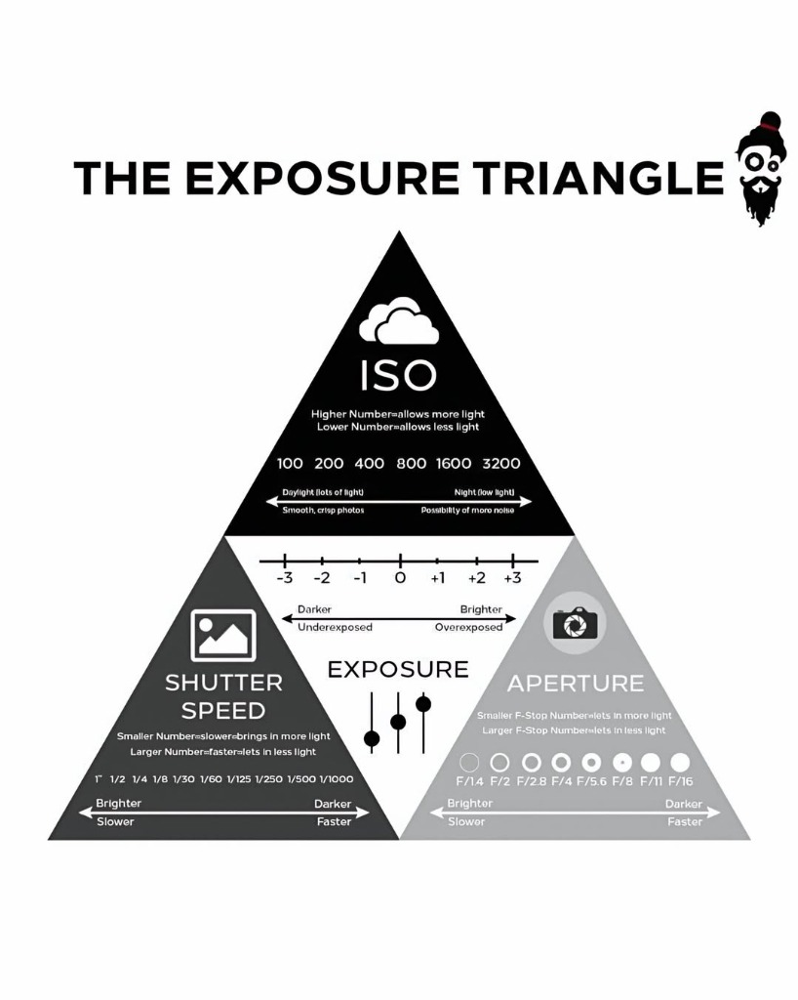

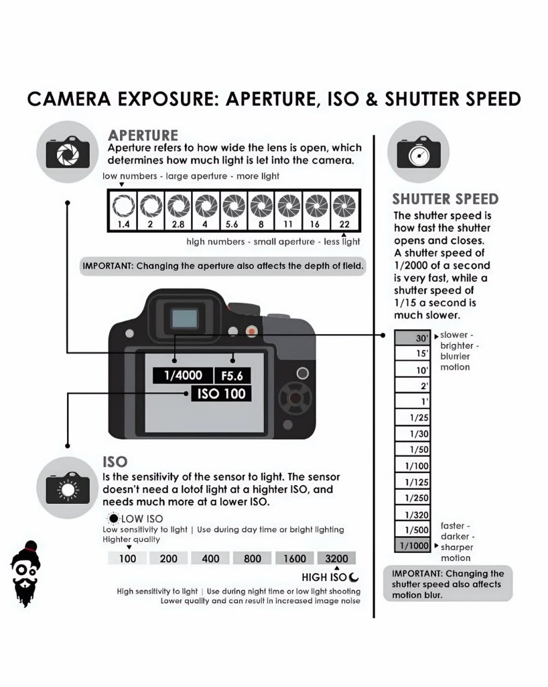

---

## 2. Camera Mode Dial & Controls
- **M (Manual):** Full control over Aperture, Shutter Speed, and ISO.
- **Av / A (Aperture Priority):** You set Aperture; camera sets Shutter Speed.
- **Tv / S (Shutter Priority):** You set Shutter Speed; camera sets Aperture.
- **P (Program):** Camera chooses both Aperture and Shutter Speed (you can still adjust ISO/WB/Exposure Compensation).
- **On-Screen Quick Items (DSLR/Mirrorless):** Shutter Speed, Aperture, ISO, Shooting Mode, Exposure Level, White Balance (`AWB`), Focus Mode (`ONE SHOT` / AF), Drive Mode (Single/Continuous), Image Quality (`L` / RAW).

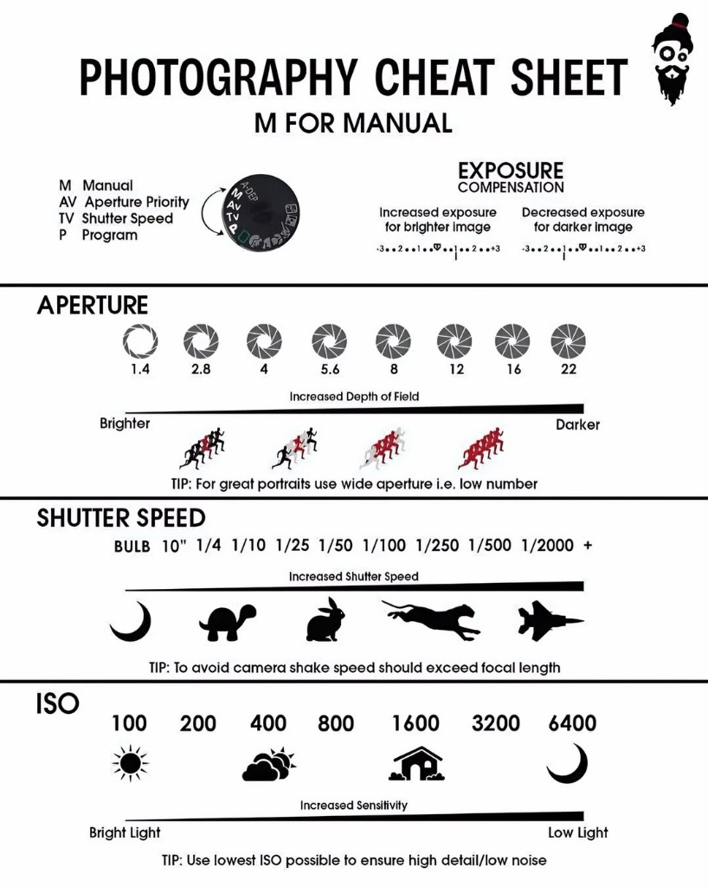

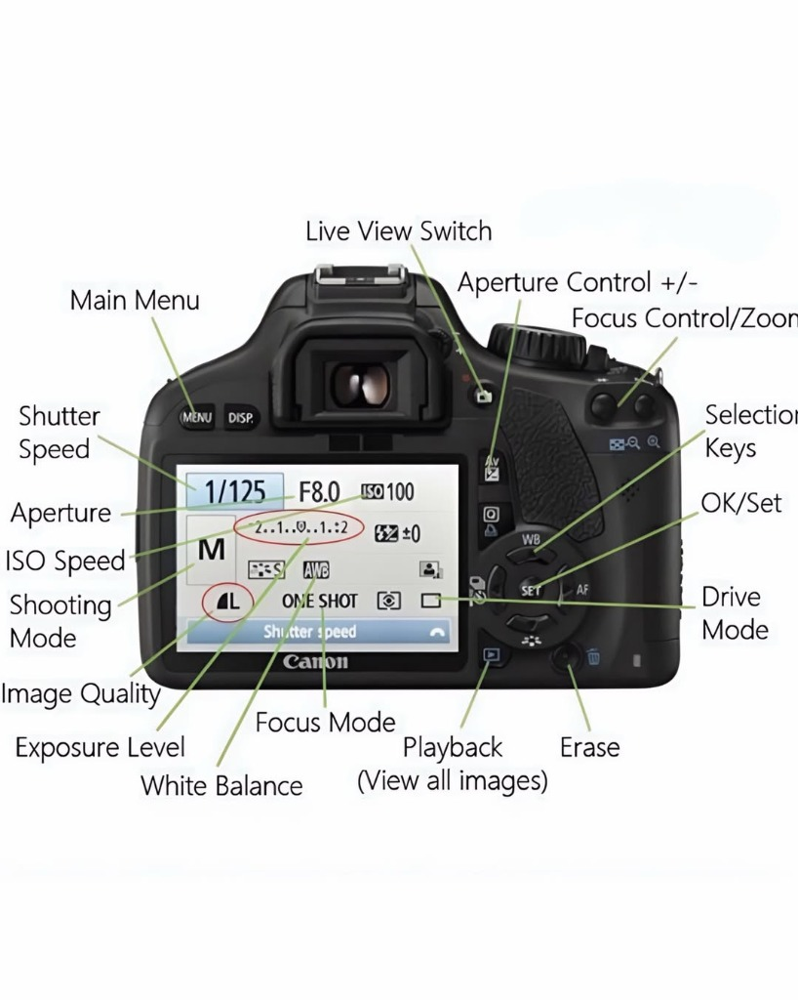

---

## 3. ISO Quick Guide (By Lighting)
- **ISO 100–200:** Bright daylight (cleanest detail, lowest noise)
- **ISO 200–400:** Shade / bright indoors
- **ISO 400–800:** Flash indoors
- **ISO 800–1600:** Darker indoors
- **ISO 1600–3200:** Indoors at night (try to stay below ~2000 when possible)
- **ISO 3200–6400+:** Extra low light (more grain/noise, lower detail)

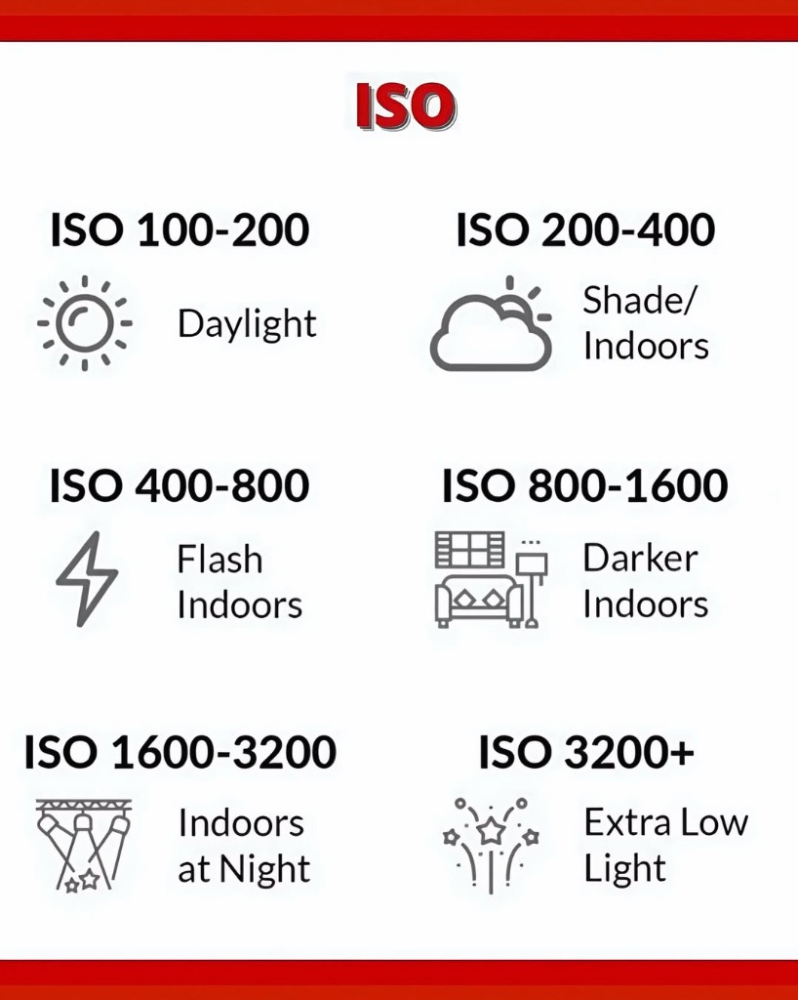

---

## 4. Aperture Cheat Sheet (By F-Stop & Subject)
- **f/1.2 – f/1.4:** Low light, portraits, razor-thin shallow depth of field
- **f/2:** Portraits (strong background blur)
- **f/2.8:** Portraits, low light, human action
- **f/4.0:** Wildlife (good balance of light and reach)
- **f/5.6:** Groups, mid-day shots, product photography (many lenses are sharpest around `f/5.6` with mild background blur)
- **f/8:** Landscapes, travel/lifestyle, real estate (nearly entire scene in focus)
- **f/11:** Macro with details (keeps fine subject depth sharp)
- **f/12 – f/16:** Landscapes with deep depth, longer daytime exposures (entire frame in focus)

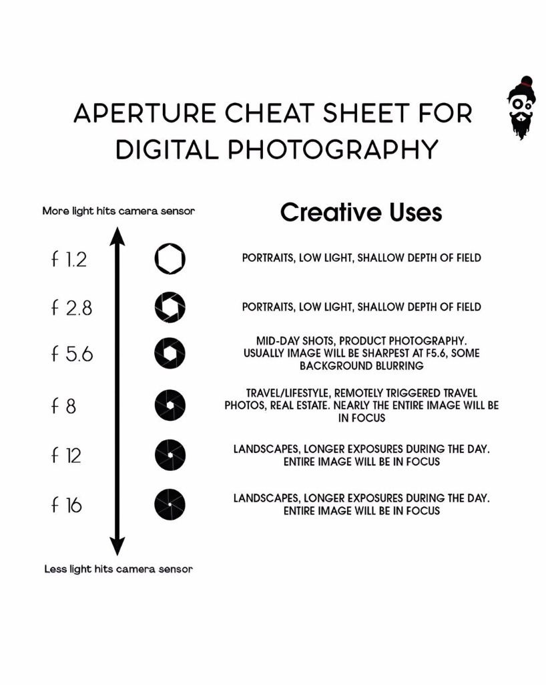

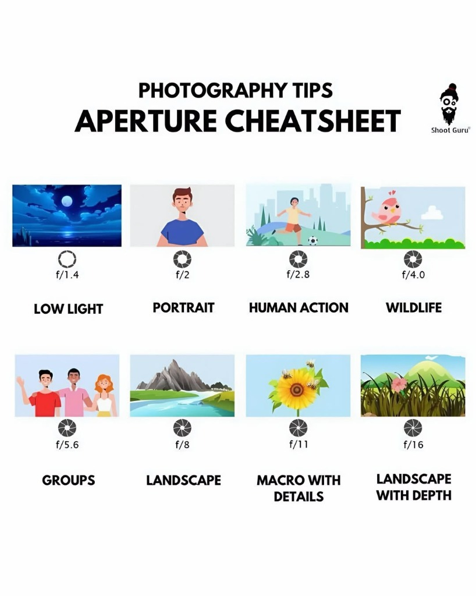

---

## 5. Shutter Speed Cheat Sheet & Anti-Shake Rule
- **1/4000s:** Fast animals, sports
- **1/2000s:** Sunset / sunrise, ultra-fast action
- **1/1000s:** Races, extreme sports
- **1/500s:** Slower sports
- **1/250s:** Casual everyday photography
- **1/120s:** Panning fast cars / vehicles
- **1/60s:** Panning slower objects (minimum classic handheld threshold; travel guide suggests ~1/80s)
- **1/30s:** Blurring motion
- **1/15s:** Low light without flash (tripod/stabilization recommended)
- **1/8s:** Blurring moving water
- **1/4s:** Blurring motion
- **1/2s:** Extreme low light
- **1" (1 sec):** Fireworks
- **5–30":** Light painting, starscapes
- **BULB:** Night sky, extra-long exposures (shutter stays open while held/triggered)

### Anti-Camera-Shake Rule (Reciprocal Rule)
- To avoid handheld camera shake, **shutter speed should be faster than `1 / focal length`** (e.g., `50mm` lens → at least `1/50s`–`1/60s`; `200mm` lens → at least `1/200s`–`1/250s`).

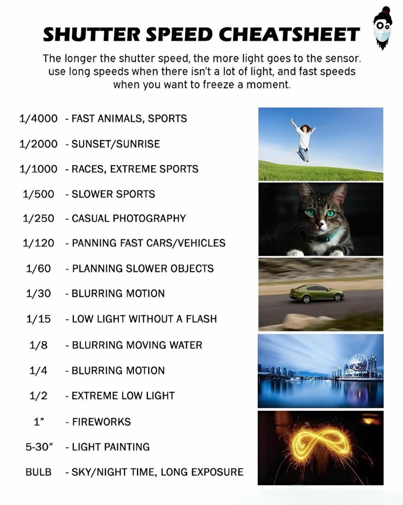

---

## 6. Outdoor Exposure: Sunny 16 Rule
Set **Shutter Speed ≈ 1 / ISO** (e.g., ISO 100 → `1/125s`, ISO 400 → `1/500s`, ISO 800 → `1/1000s`), then set Aperture by sunlight:
- **Snow / Sand:** `f/22`
- **Sunny (Hard Shadows):** `f/16`
- **Sunny (Soft Shadows):** `f/11`
- **Cloudy:** `f/8`
- **Shade:** `f/5.6`
*(Note: For side-lit or back-lit subjects, open up 1–2 stops if exposing for the subject rather than the bright sky.)*

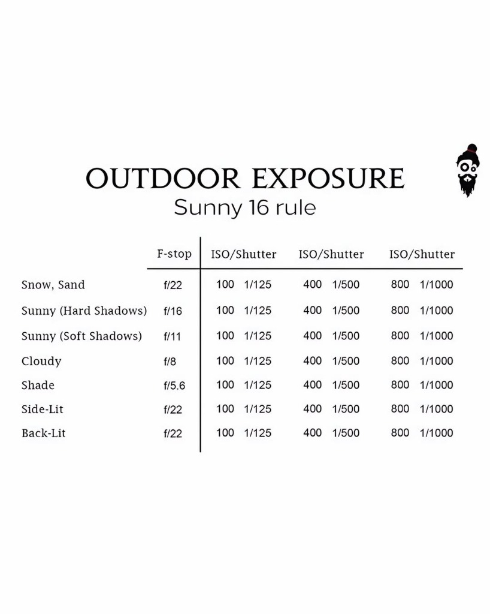

---

## 7. Focal Length & Angle of View Guide (Full-Frame)
- **Fisheye (180°):** Ultra-curved wide perspective
- **14mm (114°) – 24mm (84°):** **Extreme Wide Angle** — Architecture, interiors
- **28mm (75°) – 35mm (63°):** **Wide Angle** — Landscapes, large group portraits
- **50mm (46°):** **Normal** — Average everyday scenes, snapshots (closest to natural eye framing)
- **70mm (34°) – 100mm (24°):** **Medium Telephoto** — Portraits, children (`85mm` is classic portrait range)
- **135mm (18°) – 200mm (12°):** **Telephoto** — Close-by wildlife, sports
- **300mm (8°) – 600mm (4°):** **Super Telephoto** — Distant subjects, birds

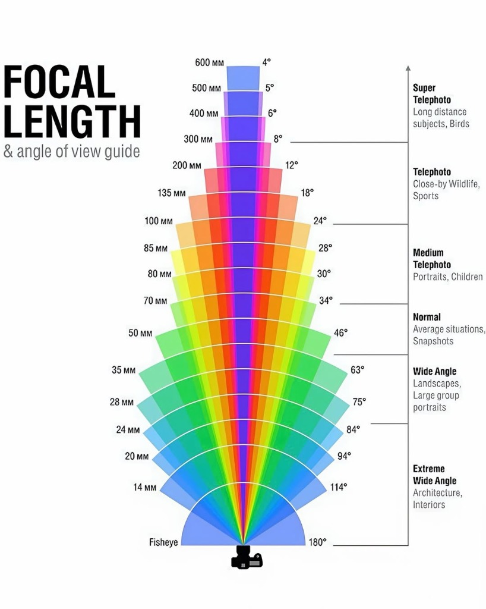

---

## 8. Metering Modes, White Balance & Travel Summary
### Metering Modes (How the Camera Reads Light)
- **Evaluative / Matrix:** Reads light across the **whole scene** (best default for most shots)
- **Center-Weighted:** Prioritizes light in the **center** of the frame
- **Spot:** Reads light from **one tiny spot** (great for backlit subjects or stage spotlights)

### White Balance Presets
- `AWB` (Auto), Daylight, Cloudy, Shade, Fluorescent, Tungsten, Flash, **Kelvin (`K`)**, **Custom**

### Example Reference Setups (Light Meter at `0`, Evaluative Metering, Custom WB)
- **Studio (controlled light):** `1/125s`, `f/8`, `ISO 100`
- **On Location (daylight portrait):** `1/250s`, `f/1.4`, `ISO 100`

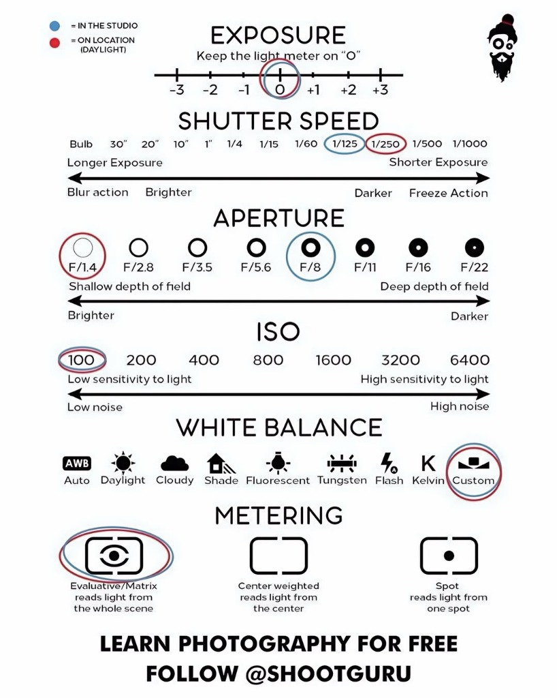

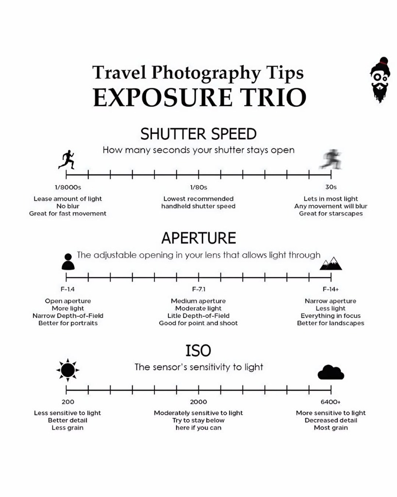
